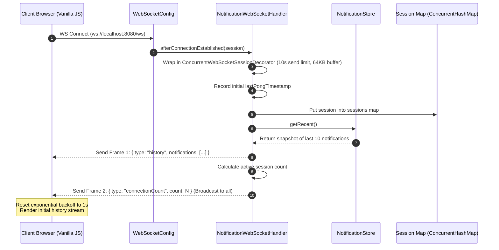
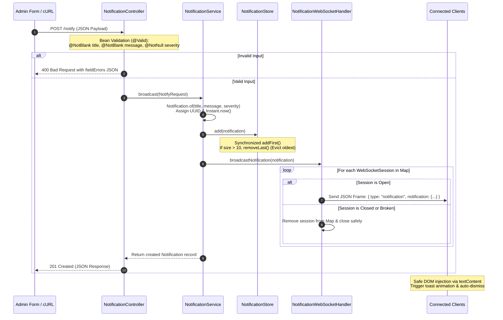
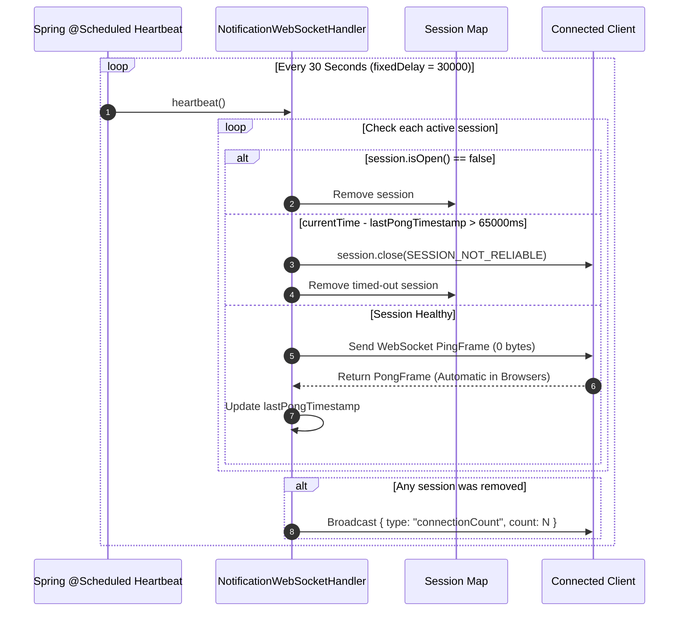
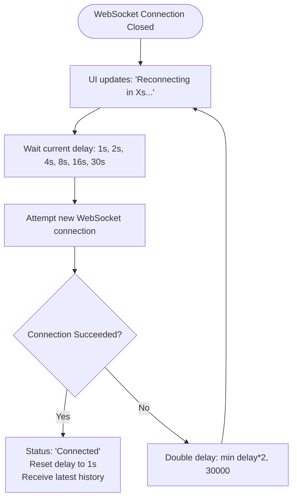

# System Workflow, Process Map & In-Memory Storage Architecture

This document provides a detailed breakdown of the internal mechanics, execution flows, and memory management strategy of the Real-Time Notification System.

---

## 1. System Architecture & High-Level Workflow

The system connects web browser clients and external services to a single Spring Boot application hosting both raw WebSocket endpoints and REST APIs.

```mermaid
graph TD
    subgraph Clients["Client Layer"]
        A[Admin Dashboard]
        C1[Client 1 - Receiver]
        C2[Client 2 - Receiver]
        EXT[External Integration / cURL]
    end

    subgraph SpringBoot["Spring Boot Backend (Port 8080)"]
        WS_CFG["WebSocketConfig (/ws)"]
        CTRL["NotificationController<br/>POST /notify & GET /notifications"]
        
        SVC["NotificationService.broadcast()<br/>(Single Entry Point)"]
        
        subgraph Storage["In-Memory Bounded Store"]
            STORE["NotificationStore<br/>(ArrayDeque, Capacity: 10, Newest-First)"]
        end
        
        subgraph WS_Engine["WebSocket Management Engine"]
            HANDLER["NotificationWebSocketHandler"]
            SESSIONS["ConcurrentHashMap&lt;String, WebSocketSession&gt;"]
            HEARTBEAT["@Scheduled Heartbeat<br/>(Every 30s: Ping/Pong & Pruning)"]
        end
    end

    %% Interactions
    A -->|1. Submit Form via POST /notify| CTRL
    EXT -->|1. HTTP POST /notify| CTRL
    CTRL -->|2. Delegate Request| SVC
    SVC -->|3. Save Recent (Capped 10)| STORE
    SVC -->|4. Push Broadcast Event| HANDLER
    HANDLER -->|5. Non-blocking Safe Push| SESSIONS
    
    C1 <-->|WebSocket Handshake /ws| WS_CFG
    C2 <-->|WebSocket Handshake /ws| WS_CFG
    A <-->|WebSocket Handshake /ws| WS_CFG
    WS_CFG --> HANDLER
    
    SESSIONS -.->|Live Notification Toasts| C1
    SESSIONS -.->|Live Notification Toasts| C2
    SESSIONS -.->|Live Connection Counter| A
    HEARTBEAT -.->|Ping & Ping Evaluation| SESSIONS
```

---

## 2. Process Maps

### Process Map 1: Client Connection & Handshake Lifecycle
When an admin or client loads their page in the browser:



---

### Process Map 2: Unified Broadcast Pipeline
Both the Admin Web Form and `POST /notify` follow the identical code path:



---

### Process Map 3: Heartbeat, Timeout & Disconnect Process
Ensures the server never retains zombie sessions or dead sockets:



---

### Process Map 4: Client-Side Reconnect with Exponential Backoff
When the backend restarts or network drops temporarily:



---

## 3. How Memory is Saved & Managed

### 1. In-Memory Ring Buffer / Capped Deque
Instead of relying on a database or an unbounded `List` that grows indefinitely and eventually causes `OutOfMemoryError` (OOM), the application implements a strict **bounded queue** in [`NotificationStore.java`](file:///c:/Users/athar/Desktop/iRIS/src/main/java/com/example/notifications/service/NotificationStore.java):

```java
public class NotificationStore {
    public static final int MAX_CAPACITY = 10;
    private final Deque<Notification> deque = new ArrayDeque<>(MAX_CAPACITY);

    public synchronized void add(Notification notification) {
        if (notification == null) return;
        if (deque.size() >= MAX_CAPACITY) {
            deque.removeLast(); // Constant-time O(1) eviction of the oldest item
        }
        deque.addFirst(notification); // Constant-time O(1) insertion of newest item
    }

    public synchronized List<Notification> getRecent() {
        return Collections.unmodifiableList(new ArrayList<>(deque));
    }
}
```

#### Why `ArrayDeque`?
- **Zero Pointer Overhead**: Unlike `LinkedList`, which allocates a `Node` object with two reference pointers (`prev` and `next`) for every stored entry, `ArrayDeque` is backed by a circular array.
- **Fixed Memory Footprint**: The capacity is capped at 10. Memory consumption never exceeds $\approx 10 \times \text{size of Notification}$.
- **Garbage Collection (GC) Friendliness**: Evicted objects immediately become unreachable and are collected in the Young Generation (Eden/Survivor spaces) without promoting to the Tenured/Old generation.

### 2. Memory Bound Calculation

| Component | Maximum Elements | Approximate Size per Element | Total Memory Overhead |
| :--- | :--- | :--- | :--- |
| `Notification` Record | 10 | ~256 bytes (UUID + Title [max 100] + Message [max 500] + Instant) | **< 4 KB** |
| `ArrayDeque` Array Reference | 16 elements (internal power of 2) | 8 bytes per reference | **~128 bytes** |
| `sessions` (`ConcurrentHashMap`) | 1 per active client | ~128 bytes entry + session descriptor | Scales strictly $O(N)$ with active users |

**Result:** The core notification store consumes less than **5 Kilobytes** of RAM regardless of whether the server runs for 10 minutes or 10 months.

---

### 3. Preventing Memory Leaks from Dead WebSocket Sockets
In raw WebSockets, unhandled socket disconnections or half-open connections can hold file descriptors and memory buffers permanently. The system prevents this through three defensive layers:

1. **`ConcurrentWebSocketSessionDecorator`**:
   - Caps outgoing message buffer to `64 KB`.
   - Sets a hard limit on send execution time (`10,000 ms`).
   - If a client stalls, Spring drops buffered messages rather than buffering endlessly in memory.
2. **Dual-Hook Cleanups**:
   - Sessions are cleared from memory in both `afterConnectionClosed` and `handleTransportError`.
3. **Heartbeat Sweep**:
   - Every 30 seconds, `heartbeat()` prunes non-responsive sessions, ensuring the `sessions` map never retains references to unreachable clients.

---

### 4. DOM Memory Management (Client Side)
On the browser side:
- **Admin Page**: The recent history list in the DOM is hard-capped to 10 elements via `while (historyList.children.length > 10) historyList.removeChild(historyList.lastChild);`.
- **Client Page Toasts**: Auto-dismiss timers (5s for Info, 7s for Warning) remove the toast DOM nodes and clear internal timer handles to keep the browser lightweight and responsive.
